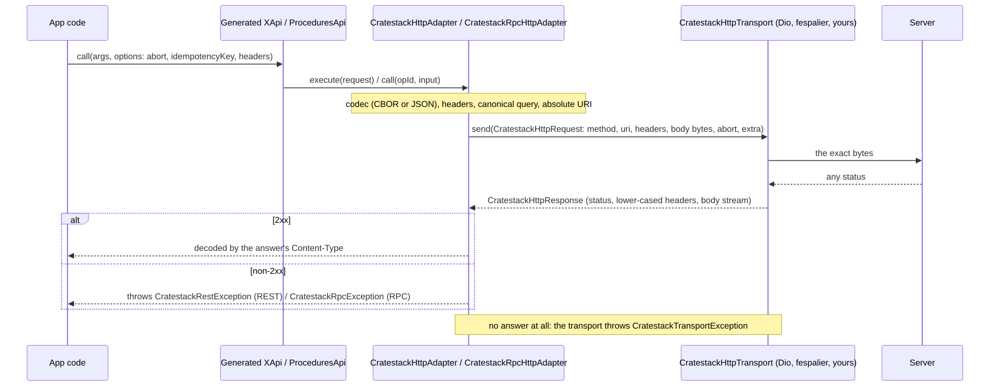
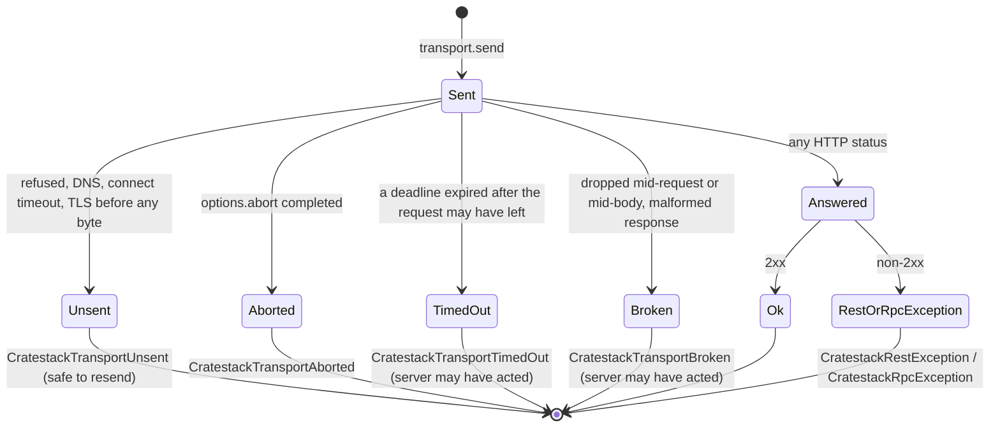

# The generated Dart client's HTTP transport

*(since 0.16.0, cratestack#1204, PR #1206.)* Everything here shipped in 0.16.0.
If `cratestack --version` is older, the generated `runtime.dart` still has the four
`*DioAdapter` classes and none of this exists: regenerate with a 0.16.0 or newer CLI,
or do not use this page.

Source of truth, in the framework repo: `crates/cratestack-client-dart/templates/`
(`http_runtime/seam.dart.j2`, `rest_runtime/http_adapter.dart.j2`,
`rpc_runtime/http_adapter.dart.j2`, `rpc_runtime/types.dart.j2`,
`dio-transport.dart.j2`, `fespalier-transport.dart.j2`), the `## 0.16.0`
entries for #1204 in `CHANGELOG.md`, and `crates/cratestack-client-dart/README.md`.
Every name below was read from those templates.

## The layers

Every generated `lib/src/runtime.dart` (all presets, REST and RPC) declares the
same pure-Dart seam. The adapters are written once over it; the HTTP stack is a
transport you pick.



| Layer | Name | Owns |
| --- | --- | --- |
| Interface the generated APIs call | `CratestackClientAdapter` (REST), `CratestackRpcAdapter` (RPC) | nothing; they are the contract |
| The one adapter per protocol | `CratestackHttpAdapter`, `CratestackRpcHttpAdapter` | headers, CBOR/JSON, `Content-Type` dispatch, the query string, error mapping |
| The seam | `CratestackHttpTransport` (`send(CratestackHttpRequest) -> CratestackHttpResponse`) | the connection, retries, deadlines, interception |
| A transport | `CratestackDioTransport(dio)`, `CratestackFespalierTransport(httpTransport)`, or your own | one HTTP stack |

The seam, the request and response types and the exceptions have no dependency.
Only `lib/src/dio_transport.dart` names Dio. Under `--preset fespalier`,
`fespalier_transport` is imported by `lib/src/fespalier_transport.dart` and by the
provider file `lib/src/client.dart` (its providers are `Provider<HttpTransport>`).

## Constructing an adapter

```dart
// REST. format defaults to CratestackWireFormat.cbor.
final adapter = CratestackHttpAdapter(
  CratestackDioTransport(dio),
  baseUri: Uri.parse('https://api.example.com'),
  // format: CratestackWireFormat.json,
  // useRustTransport: true,   // REST only; see below
);
final client = MyClient(adapter, basePath: '/api');   // MyClient is `client_class_name`

// RPC. No basePath: the adapter joins `/rpc/...` onto baseUri.
final rpcAdapter = CratestackRpcHttpAdapter(
  CratestackDioTransport(dio),
  baseUri: Uri.parse('https://api.example.com'),
);
final rpcClient = MyClient(rpcAdapter);
```

- `baseUri` replaces `dio.options.baseUrl`, which `CratestackDioTransport` **no
  longer reads**: the adapter sends an absolute URI. A path prefix on `baseUri`
  (`https://example.com/v1`) is kept. Do not set both and expect them to add up.
- `format` is the request-body format and the `Accept` preference. The answer is
  always decoded by its own `Content-Type`, so a JSON adapter still reads a CBOR
  answer. CBOR is the default, as it was for the `Cbor*` adapters.
- Interceptors, base headers, certificate pinning and retry configured on the
  `Dio` keep working under `CratestackDioTransport`. An interceptor that reads
  `options.path` now sees an absolute URI.
- `useRustTransport` (REST only) puts `cratestackUseRustTransportExtraKey` in
  `CratestackHttpRequest.extra`; `CratestackDioTransport` copies `extra` into
  `Options.extra` for a host interceptor. It is never a header.
- A response of an unsupported `Content-Type` is a `FormatException` on the JSON
  REST adapter too (it used to return the raw string).

## Never write these: the four removed adapters

`CratestackDioAdapter`, `CratestackCborDioAdapter`, `CratestackRpcDioAdapter` and
`CratestackRpcCborDioAdapter` are **deleted, with no aliases** (breaking). Code
that names one does not compile against a regenerated package. Do not write one
from memory, from an older doc page, or from the docs site (which may still show
them). The replacement is one line each:

| Before | After |
| --- | --- |
| `CratestackCborDioAdapter(dio: dio)` | `CratestackHttpAdapter(CratestackDioTransport(dio), baseUri: Uri.parse(baseUrl))` |
| `CratestackDioAdapter(dio: dio, useRustTransport: r)` | `CratestackHttpAdapter(CratestackDioTransport(dio), baseUri: Uri.parse(baseUrl), format: CratestackWireFormat.json, useRustTransport: r)` |
| `CratestackRpcCborDioAdapter(dio: dio)` | `CratestackRpcHttpAdapter(CratestackDioTransport(dio), baseUri: Uri.parse(baseUrl))` |
| `CratestackRpcDioAdapter(dio: dio)` | `CratestackRpcHttpAdapter(CratestackDioTransport(dio), baseUri: Uri.parse(baseUrl), format: CratestackWireFormat.json)` |

The **JSON** adapters become `format: CratestackWireFormat.json`; the CBOR ones
take the default. `baseUrl` is whatever was in `dio.options.baseUrl`.

## Upgrading an app: the checklist

1. Regenerate the package with a CLI that has the change, then
   `dart run build_runner build --delete-conflicting-outputs`
   (or `--run-build-runner`).
2. Grep the app and its tests for the four removed names and rewrite each with the
   table above. Typical sites: a provider override
   (`<prefix>AdapterProvider.overrideWithValue(...)`), a test double, a DI module.
3. Move `dio.options.baseUrl` into `baseUri`. If the old URL had a path (`/v1`),
   put it in `baseUri`; it is kept.
4. Replace every `on DioException` around a generated call:
   - an HTTP error answer is `CratestackRestException` (REST) or
     `CratestackRpcException` (RPC);
   - no answer is `CratestackTransportException` (see below).
   The `DioException` is usually still reachable as `.cause` of the transport
   exception.
5. Check query values. A `null` in a query map is now **omitted**; Dio used to send
   a bare `key`. The generated query builders never emit `null`, so this bites only
   hand-built `queryParameters`. If the server read a bare `key` as "present",
   send an explicit value instead.
6. Check anything that read `options.path` in a Dio interceptor: it is absolute.
7. Run the app against a server and confirm the wire did not change. It should not:
   method, URI with query, headers and body bytes are pinned against the retired
   adapters by the framework's `wire_parity_*` tests.

## Errors



| Exception | When | Carries |
| --- | --- | --- |
| `CratestackRestException` | REST, non-2xx answer | `status`, `body` (the decoded CBOR/JSON error body, the text of any other `Content-Type`, or `null` if absent or undecodable) |
| `CratestackRpcException` | RPC, non-2xx answer | `status`, `body` (`RpcErrorBody`), and getters `code`, `message`, `details`. A body that did not decode becomes `code: internal`, `message: 'HTTP <status>'`. Codes are `CratestackRpcErrorCodes.*` |
| `CratestackTransportUnsent` | the request provably never left the device | `cause`, `message`. **Always safe to resend, even a non-idempotent call.** |
| `CratestackTransportAborted` | `options.abort` completed | `cause`, `message` |
| `CratestackTransportTimedOut` | a deadline expired after the request may have left | `cause`. The server may have acted: retry only with an idempotency key |
| `CratestackTransportBroken` | anything else without an answer | `cause`. The server may have acted |

- `CratestackTransportException` is `sealed`, so a `switch` over the four is
  exhaustive and needs no default.
- `on CratestackRestException` / `on CratestackRpcException` means "the server
  said no" and nothing else. Network failure is never one of these.
- `CratestackRestException` is **new**: REST used to leak a raw `DioException`
  from `execute`. Any "REST has no typed remote error" statement is out of date.
- A transport must resolve for **every** status and throw only for no answer. A
  hand-written transport that throws on 404 turns an answer into a
  `CratestackTransportException`.

### Reading a validation refusal over RPC

A rejected field over RPC is `422` with code `invalid_argument` (REST: `422
VALIDATION_ERROR`). `fespalier_cratestack` reads both as `FieldErrors` (RPC since
fespalier#277, in the `v0.21.1` tag and on `main`; the `v0.21.0` tag does not have
it, checked by grep of its `lib/`). With plain `catch` the app sees
`CratestackRpcException(status: 422, code: 'invalid_argument')`; there is no
generated field-error type. Do not branch on the message text.

## Call options

| Field | `CratestackCallOptions` (REST) | `CratestackRpcCallOptions` (RPC) |
| --- | --- | --- |
| `headers` | yes; win over the adapter's own | yes |
| `idempotencyKey` | yes, sent as `Idempotency-Key` | yes, sent as `Idempotency-Key` (unary `call` only) |
| `abort` | yes | yes |

`abort` is a `Future<void>?`. Completing it cancels the send at any stage,
including while the response body is streaming, and the call throws
`CratestackTransportAborted`.

```dart
final cancel = Completer<void>();
final future = client.procedures.someCall(
  args,
  options: CratestackRpcCallOptions(abort: cancel.future, idempotencyKey: 'order-42'),
);
cancel.complete();   // the call throws CratestackTransportAborted
```

`idempotencyKey` on REST is new; RPC already had it. RPC sends it on the unary
`call` only, not on `batch` or `stream` (a batch carries `idem` per frame in
`RpcRequest`). The framework mints nothing: the app generates the key once per
logical operation and reuses it on retry. See `cratestack-data-integrity`.

**Limit: call options cannot carry transport attributes (cratestack#1207, open).**
`CratestackHttpRequest.extra` exists and fespalier forwards it as
`TransportRequest.attributes`, but neither options type can fill it, so a call
cannot tell the transport chain "sign with the user-present key". The example's
workaround: the call sets a header (`x-fespalier-confirm: <caption>`) and a
decorator **above** the session turns it into the attributes and strips it before
the wire. Do not invent an `extra:` parameter on the options.

## Streaming

`CratestackRpcHttpAdapter.stream()` no longer buffers the response. It reads an
`application/cbor-seq` answer as it arrives (`CborSeqStreamTransformer`), so items
are yielded before the body ends. A final `Tag(48900, RpcErrorBody)` item is turned
into a `CratestackRpcException`. The boundary scanner defaults to the pure-Dart
`CratestackCborSeqScanner`; pass `cborSeqDecoder:` (a `CborSeqDecoderHandle
Function()`) to use another, such as an FFI-backed one. A single-array
`application/cbor` or JSON answer is still read whole and then yielded item by
item. The server side is `@stream`, see `cratestack-rpc`.

`stream()` is an `async*` generator: nothing is sent until the stream is listened
to, and every failure (a transport exception, a non-2xx answer, the in-band error
item) arrives as the **stream's error**, not as an exception from the call. Consume
it with `await for` inside `try`.

## Query encoding

A canonical encoder (`cratestackCanonicalizeQuery`) builds the query string and the
REST adapter appends it, so no HTTP client's list or null rule applies:

- pairs in map order; keys and values through `Uri.encodeQueryComponent`;
- a list repeats its key: `tag=a&tag=b`;
- a nested map nests with literal brackets: `filter[kind]=x`;
- **a `null` value is omitted**, never a bare `key`;
- anything else is its `toString()`.

For every value the generated query builders emit, the bytes equal what Dio sent.

## Choosing a preset

| Preset | Pick it when | You get | HTTP stack |
| --- | --- | --- | --- |
| `default` | a plain Dart or Flutter package, no code-generated state layer, or you will wrap the client yourself | `lib/src/models.dart` + `apis.dart`, the transport seam, `<prefix>AdapterProvider` / `ClientProvider` | Dio via `CratestackDioTransport`, or any transport you write |
| `riverpod` | a Riverpod app that wants one file per model and a provider per operation (reads are providers, writes are controllers) and already has, or is happy to have, a Dio | per-model files, `@riverpod` providers, `dart_mappable` models | Dio via `CratestackDioTransport`, or any transport you write |
| `fespalier` | the app is built on fespalier, or its HTTP stack is a `fespalier_transport` chain (a signing or session decorator, a portal check, spans) and you do not want a second HTTP client under it | the `riverpod` output, sending through fespalier's `HttpTransport` | `fespalier_transport` by git; **no `dio`** |

Rules of thumb:

- Choose by the **HTTP stack the app already owns**, not by taste. If requests must
  pass through fespalier decorators, `fespalier` is the only preset that does it
  with no Dio in front. If the app has a Dio with interceptors, keep `riverpod`
  or `default`.
- `fespalier` is `riverpod` plus a different transport. It is not a fourth layout.
  An existing `riverpod` app moves to it by changing the preset and the overrides,
  not the call sites.
- A custom stack that is neither Dio nor fespalier does not need a preset: implement
  `CratestackHttpTransport` and use `default` or `riverpod`. Both still list `dio`
  in the pubspec; that is a dependency of the generated package, not a requirement
  to pass one.

## `--preset fespalier`

```bash
cratestack generate-dart --schema schema.cstack --out ./client \
  --library-name orders_client --preset fespalier --run-build-runner
# pin fespalier at another tag, branch or commit:
#   --fespalier-ref v0.21.1
```

- `--fespalier-ref <REF>` is accepted **only** with `--preset fespalier` (any other
  preset is an error: `--fespalier-ref only applies to --preset fespalier`), and
  must be non-empty with no whitespace. Default `v0.21.0`, a generator constant.
  fespalier has tags `v0.21.0` and `v0.21.1`; both have the transport types the
  generated file uses, and only `v0.21.1` has the RPC validation reading in
  `fespalier_cratestack` (see above). `--fespalier-ref` pins only the generated
  package's `fespalier_transport`; it must match the ref of the app's other fespalier
  packages, or pub reports a git-source conflict. An RPC app that wants field errors
  depends on `fespalier_cratestack` at `v0.21.1` or later and passes that same ref.
- The pubspec depends on `fespalier_transport` by **git**
  (`url: https://github.com/fespalier/fespalier`, `path: packages/fespalier_transport`,
  `ref: <fespalier-ref>`). It is not on pub.dev, and `dio` is not a dependency.
  Resolution needs the ref to be reachable. In a monorepo that holds fespalier,
  override it with `pubspec_overrides.yaml` pointing at the checkout.
- The preset emits `lib/src/fespalier_transport.dart` (`CratestackFespalierTransport`)
  and **no** `lib/src/dio_transport.dart`.
- Providers, with `<prefix>` the camel-cased `--library-name` (`orders_client` ->
  `ordersClient`):
  - `<prefix>TransportProvider` (`Provider<HttpTransport>`) and
    `<prefix>BaseUriProvider` (`Provider<Uri>`) **throw `UnimplementedError` until
    the app overrides them**;
  - `<prefix>AdapterProvider` defaults to `CratestackHttpAdapter` /
    `CratestackRpcHttpAdapter` over `CratestackFespalierTransport(ref.watch(<prefix>TransportProvider))`
    and `ref.watch(<prefix>BaseUriProvider)`, so an app does **not** override it
    unless it changes the format;
  - `<prefix>BasePathProvider` (REST only) is the request path prefix, unchanged;
    the base URI is the server's origin, so keep them apart.

```dart
ProviderScope(
  overrides: [
    ordersClientTransportProvider.overrideWith(
      (ref) => SessionTransport(
        WriteGuardTransport(HttpClientTransport(client)),
        ref.watch(credentialsProvider),
      ),
    ),
    ordersClientBaseUriProvider.overrideWithValue(Uri.parse('https://api.example.com')),
  ],
  child: const MyApp(),
)
```

What `CratestackFespalierTransport` does:

- Sends the exact body bytes and the headers; `CratestackHttpRequest.extra` goes
  out as `TransportRequest.attributes` and never on the wire. A signer above it sees
  the same bytes the adapter encoded.
- **Abort is merged**: the call option's `abort` and the current `TransportZone`'s
  trigger (`TransportZone.merge`). Either aborts, so `ref.cancellable` in
  `fespalier_cratestack` aborts a page's loads with no wiring, even for a call that
  carries its own `abort`.
- Every status is an answer. A `TransportStatusError` thrown by a decorator is
  treated as the answer it carries, so it becomes `CratestackRestException` /
  `CratestackRpcException`.
- `TransportAborted`, `TransportUnsent`, `TransportTimedOut`, `TransportBroken` map
  one to one onto the `CratestackTransport*` kinds. `TransportPortal` and
  `TransportUntrusted` become `CratestackTransportBroken` (the seam has no kind for
  them); the original is `cause`, so tell them apart with
  `error.cause is TransportPortal`.
- **Any other error a decorator throws (for example `AuthRejected`) reaches the
  caller unchanged.** Do not assume every failure is a `CratestackException` type.

### The reference example

fespalier's `examples/cratestack`
(<https://github.com/fespalier/fespalier/tree/main/examples/cratestack>, from
fespalier#277) is the worked version: a Rust CrateStack server (`server/`,
`cratestack-api` 0.15.4, no database), a client **generated** with `--preset
fespalier` (`client/`, committed, regenerated and compared in CI), and device-signed
sessions (`fespalier_sign_keypair`: no password, no token, no `Authorization`
header). It is RPC, uses `--no-native-cbor` so the client needs no native library,
and pins the CLI by commit. Read it for the wiring (`lib/src/wiring.dart`) before
inventing one. It also demonstrates the two limits below.

### Known gaps, with their workarounds

- **cratestack#1207, call options cannot carry transport attributes** (above).
  Workaround: a header that a decorator above the session turns into attributes and
  strips.
- **cratestack#1208, an `AuthProvider` refusal cannot shape its status or body** *(fixed,
  unreleased: `AuthRefusal`, see `cratestack-policy-auth`; the workaround below is for 0.17.0
  and earlier)*.
  `AuthProvider::authenticate` returns an error that becomes the standard
  `{code, message}` envelope, so a provider cannot add a member such as
  `{"error": "attestation_expired"}` that a client-side session classifier reads.
  Workaround in the example: the verification runs in a **layer in front of the
  router** that writes its own 401/403, and the `AuthProvider` only converts what the
  layer recorded into a `CratestackContext`. Do not move that check into the
  `AuthProvider` and expect the client to tell "renew" from "wipe". See
  `cratestack-policy-auth`.

Both are open: confirm on the issues before telling a user they are still gaps.

## A transport of your own

Implement one method. Resolve for every HTTP status; throw a
`CratestackTransportException` only when there is no answer. Send
`request.body` byte for byte and add no header the request does not carry.

```dart
class MyTransport implements CratestackHttpTransport {
  @override
  Future<CratestackHttpResponse> send(CratestackHttpRequest request) async {
    // request.method, request.uri (absolute, query included), request.headers,
    // request.body (the exact bytes, or null), request.abort (completes when the
    // caller gives up), request.extra (never sent).
    // Return CratestackHttpResponse(status:, headers:, body: Stream<Uint8List>);
    // CratestackHttpResponse.buffered(...) is handy in tests.
    throw UnimplementedError();
  }
}
```

Response header names are lower-cased by the type. `body` is single-subscription.
Retries, deadlines and interception are the transport's job, not the adapter's.
`CratestackHttpResponse.buffered` is the test double: a fake transport that returns
canned answers replaces the old practice of mocking Dio.

## What is unchanged

The wire: methods, URIs, headers, body bytes, and the `x-cratestack-schema-sha`
header. The `cratestack_cbor` codec cache (one copy now, shared by both adapters).
`--no-native-cbor`. The `Accept` preference per format. Model and procedure API
names.
